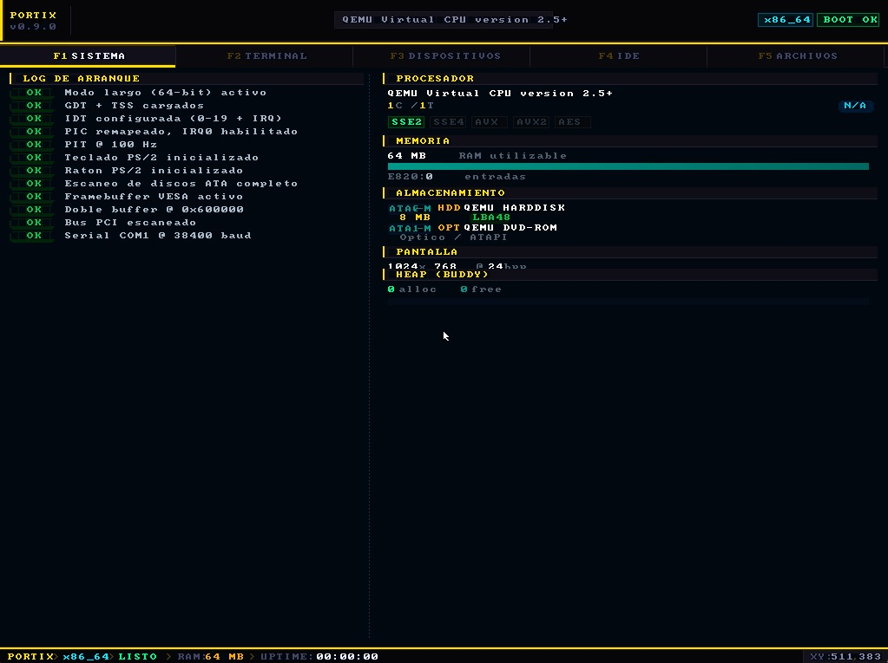
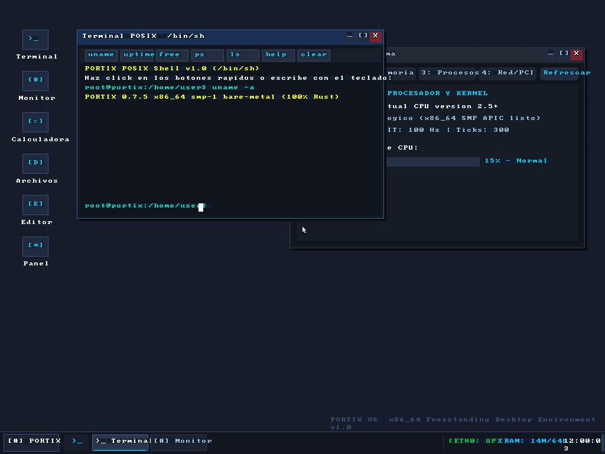

# Portix OS

<div align="center">


-orange?style=for-the-badge&logo=rust)


**Sistema operativo soberano de 64 bits, escrito 100% en Rust (`no_std`) desde cero.**
*Sin Linux. Sin libc. Sin GRUB. Cero dependencias externas en el núcleo.*

**Autor:** Omar Palomares Velasco

[📋 Auditoría Técnica](docs/PORTIX_STATUS_REAL_VERIFICADO.md) • [📜 Changelog](CHANGELOG.md) • [🛠️ Bitácora](AGENTS.md) • [🐛 Tickets](docs/TICKETS.md)

</div>

---

## Tabla de contenidos

- [¿Qué es Portix OS?](#qué-es-portix-os)
- [Arquitectura](#arquitectura)
- [Estructura del repositorio](#estructura-del-repositorio)
- [Subsistemas del núcleo](#subsistemas-del-núcleo)
- [Utilidades Ring 3](#utilidades-ring-3)
- [Requisitos del anfitrión](#requisitos-del-anfitrión)
- [Compilación](#compilación)
- [Ejecución en QEMU](#ejecución-en-qemu)
- [Pruebas automatizadas](#pruebas-automatizadas)
- [Documentación](#documentación)
- [Licencia](#licencia)

---

## Captura del sistema

### Antes y después





## ¿Qué es Portix OS?

Portix OS es un sistema operativo de 64 bits (x86_64) desarrollado desde cero en Rust freestanding
(`#![no_std]`). No se basa en Linux, no usa GRUB ni libc: implementa su propio cargador BIOS
(Stage 2 en ensamblador) y un cargador UEFI nativo (`BOOTX64.EFI`, en Rust puro).

El núcleo no tiene dependencias externas (`[dependencies]` vacío en `kernel/Cargo.toml`).

### Características verificadas

- **Microkernel modular**: Ring 0 / Ring 3 con Fast-IPC en registros y VMOs en memoria compartida.
- **Gestión de memoria**: Buddy allocator (64 MiB, órdenes 0-11), paginación de 4 niveles x86_64, COW en `fork` con conteo de referencias por marco físico, asignador de marcos físicos a partir del mapa del firmware.
- **Compatibilidad binaria Linux**: 452 syscalls traducidas del ABI Linux x86_64 (verificable con `/bin/abi-linux` y `/proc/abi`).
- **Sistemas de archivos**: FAT32 (arranque/datos), ext2 RW (raíz `/`), ramfs (`/tmp`, `/dev/shm`), procfs (`/proc`), FIFOs en ext2.
- **Red**: pila TCP/IP propia sobre Intel e1000 (Ethernet, ARP, IPv4, ICMP, UDP, TCP, DNS, DHCP), IPv6 (SLAAC, NDP, ICMPv6, TCP/UDP sobre IPv6), TLS 1.3 real en Ring 3 (X25519, HKDF, ChaCha20-Poly1305, RSA, X.509).
- **SMP real**: segundo núcleo arranca y planifica (AP con GDT/TSS/LAPIC propios).
- **Señales POSIX**: SIG_DFL/SIG_IGN, sigaction, sigprocmask, entrega desde excepciones, SIGPIPE, SIGCHLD, SIGALRM.
- **Hilos reales**: clone(CLONE_VM|CLONE_THREAD), futex con cola de espera, TLS por hilo.
- **Entorno gráfico**: compositor Wayland en Ring 3 (`portix-wm`) con tiling y workspaces.
- **Shell POSIX**: `/bin/sh` con tuberías, redirección, control de trabajos (`&`, `jobs`, `fg`, `bg`, `wait`).
- **Toolchain propio**: `portix-cc` (compilador de C real), `portix-bench`, `dbg` (depurador con breakpoints por hardware).
- **Gestor de paquetes**: `pkg` (`.apk` de Alpine, `.deb` de Debian) con verificación SHA-256/RSA/OpenPGP.
- **Drivers bare-metal**: NVMe, AHCI/SATA, xHCI/USB, HDA/audio (verificados sobre QEMU con medidas reales).

Consulte la [auditoría técnica honesta](docs/PORTIX_STATUS_REAL_VERIFICADO.md) para detalles de lo probado frente a lo emulado.

---

## Arquitectura

```
kernel/
├── src/
│   ├── arch/          # CPU, IDT/ISR, paginación 4 niveles, SMP, per-CPU, MMIO, aarch64
│   ├── compat/        # i18n (ES/EN/JA/DE)
│   ├── console/       # Terminal del núcleo y comandos
│   ├── containers/    # OCI / sandbox
│   ├── crypto/        # Primitivas criptográficas del núcleo
│   ├── dev/           # Dispositivos
│   ├── drivers/       # ATA, FAT32, NVMe, e1000, xHCI, HDA, storage, mmio, silicon, bus
│   ├── fs/            # Contrato VFS + adaptadores (ext2, ramfs, FAT)
│   ├── graphics/      # Framebuffer, raytracing
│   ├── lkm/           # Módulos cargables
│   ├── mem/           # Buddy allocator, paging, marcos físicos
│   ├── microkernel/   # eBPF
│   ├── net/           # Pila de red (TCP/IP, ARP, ICMP, DHCP, DNS, IPv6)
│   ├── power/         # ACPI
│   ├── process/       # Procesos, señales, scheduler, futex, IPC
│   ├── security/      # TPM, sandbox
│   ├── syscall/       # Despachador nativo + traductor ABI Linux
│   ├── system/        # devsuite, consagración, profiler, symbols
│   ├── time/          # PIT, RTC
│   ├── ui/            # Compositor de ventanas, terminal gráfica
│   ├── util/          # Formateo
│   └── wasm/          # WASM/WASI
├── x86_64-portix.json # target spec para cargo
└── Cargo.toml         # sin dependencias externas
userland/
├── bin/               # ~70 utilidades en Rust (no_std)
└── crates/portix-rt/  # runtime compartido (syscalls, TLS 1.3, VFS, allocator)
scripts/                # build.py, headless_runner.py, recertify.py, sondas
boot/                   # stage2.asm, cargador EFI
docs/                   # Documentación y bitácora
```

---

## Subsistemas del núcleo

| Subsistema | Módulo | Estado |
|---|---|---|
| Memoria (buddy + marcos) | `mem/` | Real y verificado |
| Paginación 4 niveles | `mem/paging.rs` | Real y verificado |
| Procesos / scheduler / SMP | `process/`, `arch/smp.rs` | Real y verificado (2 núcleos) |
| Señales POSIX | `process/signals.rs` | Real y verificado |
| Futex / hilos | `syscall/futex.rs` | Real y verificado |
| VFS (FAT32/ext2/ramfs/procfs) | `fs/`, `drivers/storage/` | Real y verificado |
| Red (TCP/IP, IPv6, TLS) | `net/`, `portix-rt/tls13/` | Real y verificado |
| Drivers bare-metal (NVMe, AHCI, xHCI, HDA) | `drivers/` | Real sobre QEMU |
| Compositor Wayland | `ui/`, `portix-wm` | Real |
| eBPF | `microkernel/ebpf.rs` | Implementado |
| WASM/WASI | `wasm/` | Implementado |
| Raytracing (Vulkan) | `graphics/raytracing.rs` | Implementado |
| AArch64 HAL | `arch/aarch64/` | Implementado (no verificado en silicio) |

---

## Estructura del repositorio

| Directorio | Contenido |
|---|---|
| `kernel/` | Núcleo Rust `no_std` |
| `userland/` | Utilidades y runtime Ring 3 |
| `boot/` | Cargador BIOS (stage2) y UEFI (BOOTX64.EFI) |
| `scripts/` | Build, suites de prueba, sondas, verificación |
| `docs/` | Bitácora, tickets, roadmap, auditoría |
| `modules/` | Módulos cargables de ejemplo |

---

## Requisitos del anfitrión

**Obligatorios**

- `rustc` + `cargo` nightly con `rust-src` (`rustup component add rust-src --toolchain nightly`)
- `nasm`
- `python3` (>= 3.10)
- `qemu-system-x86_64` y `qemu-img`

**Para imágenes ISO**

- `xorriso` (o `mkisofs`/`genisoimage`)

**Para verificación ext2 del host**

- `mke2fs` (e2fsprogs) — el build usa el de Android SDK si está disponible
- `e2fsck`, `debugfs` (opcionales)

**Para FAT32 (pyfatfs)**

- `pyfatfs` (`pip install pyfatfs`)

**Para UEFI**

- `OVMF` / `edk2-x86_64-code.fd`

En Windows (MSYS2) instale: `xorriso`, `mtools`, `dosfstools` vía pacman. `e2fsprogs` no está en MSYS2; el build usa `mke2fs` del Android SDK como fallback.

---

## Compilación

```bash
# Construcción completa (kernel + userland + imágenes)
python3 scripts/build.py

# Sólo kernel y stage2 (más rápido)
python3 scripts/build.py --no-run --no-vm --no-iso

# Reconstrucción limpia
python3 scripts/build.py --clean
```

Artefactos generados en `build/dist/`:

- `portix.iso` — ISO dual BIOS+UEFI
- `portix.img` — imagen raw BIOS (72 MB)
- `portix-uefi.img` — disco GPT completo (UEFI)
- `portix-dual.img` — imagen BIOS legacy
- `portix.vdi`, `portix.vmdk` — para VirtualBox/VMware

---

## Ejecución en QEMU

```bash
# BIOS
qemu-system-x86_64 -cdrom build/dist/portix.iso -m 512 -smp 2

# UEFI
qemu-system-x86_64 -bios /usr/share/ovmf/OVMF.fd -cdrom build/dist/portix.iso -m 512 -smp 2
```

---

## Pruebas automatizadas

```bash
# Suite headless completa
python3 scripts/headless_runner.py

# Suite interactiva (escritorio real)
python3 scripts/interactive_runner.py

# Recertificación (sin reconstruir)
python3 scripts/recertify.py --no-build

# Pipeline completo (Windows)
.\scripts\run_pipeline.ps1 -Mode all
```

La suite exige dos pasadas consecutivas con 0 fallos + recertificación para cerrar un ciclo.

---

## Documentación

- [Auditoría técnica honesta](docs/PORTIX_STATUS_REAL_VERIFICADO.md)
- [Tickets abiertos y cerrados](docs/TICKETS.md)
- [Arquitectura](docs/ARCHITECTURE.md) · [Compilación](docs/BUILD.md) · [Memoria](docs/MEMORY.md) · [Almacenamiento](docs/STORAGE.md) · [Arranque](docs/BOOT.md) · [Interfaz de usuario](docs/UI.md) · [Estándares de código](docs/CODING_STANDARDS.md)
- [Bitácora de desarrollo](AGENTS.md)
- [Historial de cambios](CHANGELOG.md)

---

## Licencia

GPL v3. Ver [LICENSE](LICENSE).